# Fed_MOPD实验、论文阅读、idea

## 实验 FedAvg_MOPD

### 实验目的与流程

尝试将 OPSD 放到三个 Non-IID 领域 Client 上进行本地训练，再通过 FedAvg 得到一个多领域全局模型。基础模型、三个 Client Student 和冻结 Teacher 均从约 4B 参数的 `Qwen3-4B-Base` 初始化。本次只有一轮联邦训练，完整流程为：

1. 在 AIME25、AIME26、IFBench、IFEval 和 LiveCodeBench 上评测未经训练的 `Qwen3-4B-Base`，作为基线；
2. Math、IF、Code 三个 Client 分别在对应领域数据上执行 OPSD；Student 只看问题，冻结 Teacher 额外看到参考答案；
3. 三个 Client 均从同一个基础模型独立开始训练，完成后对完整模型参数做等权 FedAvg；
4. 在五个测试集上评测聚合后的全局模型；
5.  Math Client 评测于 AIME25/AIME26、IF Client 评测于 IFBench/IFEval、Code Client 评测于 LiveCodeBench，观察各 Client 的本领域 OPSD 是否有效。

第三组结果是“各领域 Client 在其对应测试集上的得分”，不是同一个 Client 在全部五个 benchmark 上的跨领域结果。

### 数据集

三个 Client 各用自己领域 2,000 条数据。每条训练记录都包含问题 $x$ 和仅供 Teacher 使用的参考答案 $y^{*}$ ；原始数据不在 Client 之间交换。

| Client | 训练数据                                                         |                                      数据筛选与本轮用量 |
| ------ | ---------------------------------------------------------------- | ------------------------------------------------------: |
| Math   | `siyanzhao/Openthoughts_math_30k_opsd`，`train`              |                              排除显式标错记录；2,000 条 |
| IF     | `allenai/tulu-3-sft-personas-instruction-following`，`train` |                          目标回复作为特权答案；2,000 条 |
| Code   | `microsoft/rStar-Coder`，`seed_sft/train`                    | 仅保留`verified=True` 且 `is_passed=True`；2,000 条 |

测试集和主指标如下。

| 领域 | 测试集                      |                           规模 | 主指标                      |
| ---- | --------------------------- | -----------------------------: | --------------------------- |
| Math | AIME25                      |                          30 题 | Exact Match                 |
| Math | AIME26                      |                          30 题 | Exact Match                 |
| IF   | IFBench                     | 300 prompts / 344 instructions | Prompt-level Loose Accuracy |
| IF   | IFEval                      | 541 prompts / 834 instructions | Prompt-level Loose Accuracy |
| Code | LiveCodeBench `release_v6` |                       1,055 题 | Pass@1                      |

#### 指标说明

- **Exact Match（AIME25/AIME26）**：答对记为 1，答错记为 0，最终得分为

$$
\text{Exact Match}=\frac{\text{答案完全正确的题数}}{\text{总题数}}.
$$

AIME25 和 AIME26 都只有 30 题，因此一题对应约 **3.33 个百分点**。这意味着 3.33% 与 6.67% 实际上分别是答对 1 题和 2 题，小幅百分比变化应结合正确题数理解。

- **Instruction-level Accuracy（IFBench/IFEval）**：

$$
\text{Instruction Accuracy}=\frac{\text{通过验证的单条指令数}}{\text{指令总数}}.
$$

因此 IFBench 的分母是 344 条 instructions，IFEval 的分母是 834 条 instructions。

- **Prompt-level Accuracy（IFBench/IFEval）**：只有当一个 prompt 中的**全部指令**都通过验证时，该 prompt 才记为正确：

$$
\text{Prompt Accuracy}=\frac{\text{全部约束均通过的 prompt 数}}{\text{prompt 总数}}.
$$

它比 instruction-level 指标更严格地反映“是否完整遵循了整条用户请求”。

- **Strict 与 Loose**：Strict 直接按照严格规则检查原始回复；Loose 使用官方评测允许的宽松处理或规范化后再检查，减少格式、标点或附加文本造成的误判。虽然是Loose，但是核心指令仍必须满足，有 $\text{Loose}\geq\text{Strict}$ 。

- **Pass@1（LiveCodeBench）**：每道题只取第一个生成的程序，交给 LiveCodeBench 官方执行器和测试用例判定；只有通过该题全部测试才记为正确：

$$
\text{Pass@1}=\frac{\text{首个生成程序通过全部测试的题数}}{\text{总题数}}.
$$

本实验每题生成一次，因此这里的 Pass@1 就是 1,055 道题上的单次通过率，不是从多次采样中挑选最佳答案。

上述指标均为“越高越好”。

### 训练与评测设置

| 项目              | 设置                                                                                   |
| ----------------- | -------------------------------------------------------------------------------------- |
| 基础模型          | `Qwen/Qwen3-4B-Base`，约 4B 参数                                                     |
| 联邦设置          | 3 个逻辑 Client，1 轮；单 GPU 串行模拟                                             |
| Teacher / Student | 同一初始 checkpoint；Teacher 冻结且可见参考答案，Student 全参数训练                    |
| 本地数据与步数    | 每 Client 2,000 条，1 epoch，250 optimizer steps                                 |
| Batch             | micro-batch 1；每 prompt 1 条 rollout；梯度累计 8；有效 batch 8                        |
| Optimizer         | Adafactor，cosine schedule，warmup ratio 0.03，weight decay 0                          |
| 学习率            | Math：1×10⁻⁶；IF/Code：5×10⁻⁶                                                        |
| 训练长度          | rollout 最长 1,024 tokens；训练序列最长 4,096 tokens                                   |
| 蒸馏目标          | 全词表 forward KL，D_KL(p_T ∥ p_S)，温度 1.0                                         |
| 聚合              | 三个 Client 样本数相同，故样本加权等价于 1/3 等权参数平均                            |
| 精度与模型更新    | BF16（硬件支持时），不使用 LoRA，不使用 4-bit 量化                                     |
| 旧实验中的裁剪    | `max_grad_norm=1.0` 的参数梯度范数裁剪；**没有逐 token pointwise KL clipping** |
| 评测生成          | 最长 1,024 new tokens；temperature 0.6，top-p 0.95，top-k 20，seed 42                  |

为了能在单卡上跑，这里超参数设置相比OPSD原文比较保守，这可能也是最后优化失败的原因之一。

### 实验结果

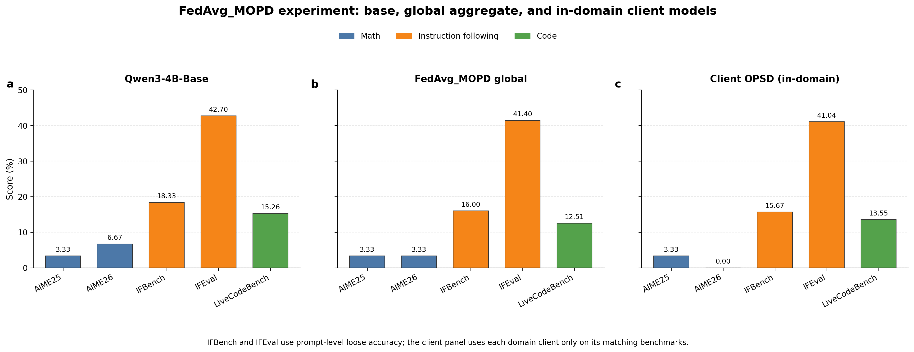

| Benchmark     | 指标         |      Qwen3-4B-Base | FedAvg_MOPD 全局模型 | 全局变化 |    对应领域 Client | Client 变化 |
| ------------- | ------------ | -----------------: | -------------------: | -------: | -----------------: | ----------: |
| AIME25        | Exact Match  |       3.33% (1/30) |         3.33% (1/30) |     0.00 |       3.33% (1/30) |        0.00 |
| AIME26        | Exact Match  |       6.67% (2/30) |         3.33% (1/30) |    -3.33 |       0.00% (0/30) |       -6.67 |
| IFBench       | Prompt Loose |    18.33% (55/300) |      16.00% (48/300) |    -2.33 |    15.67% (47/300) |       -2.67 |
| IFEval        | Prompt Loose |   42.70% (231/541) |     41.40% (224/541) |    -1.29 |   41.04% (222/541) |       -1.66 |
| LiveCodeBench | Pass@1       | 15.26% (161/1,055) |   12.51% (132/1,055) |    -2.75 | 13.55% (143/1,055) |       -1.71 |

IF 任务的四项完整指标一致下降：

| 模型        | IFBench Prompt Strict | IFBench Instruction Strict | IFBench Prompt Loose | IFBench Instruction Loose | IFEval Prompt Strict | IFEval Instruction Strict | IFEval Prompt Loose | IFEval Instruction Loose |
| ----------- | --------------------: | -------------------------: | -------------------: | ------------------------: | -------------------: | ------------------------: | ------------------: | -----------------------: |
| Base        |                14.67% |                     16.86% |               18.33% |                    21.22% |               39.19% |                    51.08% |              42.70% |                   54.56% |
| FedAvg_MOPD |                11.67% |                     12.79% |               16.00% |                    17.73% |               36.23% |                    48.56% |              41.40% |                   52.76% |
| IF Client   |                10.67% |                     12.50% |               15.67% |                    17.44% |               35.49% |                    47.48% |              41.04% |                   52.76% |

这里AIME25 和 AIME26测试上我没有用Avg@12（每道题生成12次，统计总的通过次数）。使用的是单次生成的通过率。3.33%表示30道题只做对1道。

### 结果分析：本轮 OPSD 失败

实验结果显示，Avg聚合后的模型在每一个测评上的评分基本都降低了。在怀疑超参数设置的问题之前，我对各个client上OPSD的学生在对应领域上各自做测评，结果显示client上的OPSD的结果本身就不好，所以问题出在client的OPSD上。另外Avg合并后的模型没有想象中测评结果下降那么厉害。

我重新对照OPSD原文的实验设置，感觉最可能的原因是旧实验漏掉了 OPSD 原文的 **Per-Token Pointwise Divergence Clipping**。旧实现是按照OPSD原本的做法：对每个 rollout token 直接计算完整词表上的

$$
D_{\mathrm{KL}}(p_{T}\Vert p_{S})
=\sum_{v\in\mathcal V}p_{T}(v)\left[\log p_{T}(v)-\log p_{S}(v)\right],
$$

然后跨 token 求平均，没有在词表贡献项或逐 token 层面对极端 divergence 做截断。少数异常大的 Teacher–Student 差异因此可能主导一次更新，特别是在 Student 已生成错误前缀、长序列后部或三个领域分布差异较大时。

OPSD 原文的 **Per-Token Pointwise Divergence Clipping** 不是对最终 loss 或参数梯度做裁剪，而是在每个生成位置 $n$ 上，先分别裁剪词表中每个候选 token $v$ 的 divergence contribution。为避免在公式中重复很长的条件，令 $z$ 表示参考答案等特权信息，并记

$$
q_{n,v}=p_{T}(v\mid x,z,\hat y_{1:n-1}),
\qquad
s_{n,v}=p_{S}(v\mid x,\hat y_{1:n-1}).
$$

对一般的 $f$ -divergence，位置 $n$、词表项 $v$ 的 pointwise contribution 定义为

$$
\ell_{n,v}^{(f)}
=q_{n,v}
f\left(\frac{s_{n,v}}{q_{n,v}}\right).
$$

令学生 rollout 的长度为 $T=|\hat y|$ ，裁剪后的轨迹损失为

$$
D_{\mathrm{clip}}^{(f)}(p_{T}\Vert p_{S})
=\frac{1}{T}
\sum_{n=1}^{T}\sum_{v\in\mathcal V}
\min\!\left(\ell_{n,v}^{(f)},\tau\right),
$$

其中 $\tau\gt 0$ 是 pointwise clipping threshold。计算顺序非常关键：先在每个 $(n,v)$ 上裁剪，再对完整词表 $\mathcal V$ 求和，最后对 rollout 的 $T$ 个位置取平均。

对于本实验使用的 forward KL， $f(r)=-\log r$ ，因此每个词表项的贡献为

$$
\ell_{n,v}^{\mathrm{KL}}
=p_{T,n}(v)
\log\frac{p_{T,n}(v)}{p_{S,n}(v)},
$$

相应的 clipped forward-KL loss 为

$$
\mathcal L_{\mathrm{clip}}
=\frac{1}{T}\sum_{n=1}^{T}\sum_{v\in\mathcal V}
\min\!\left(
p_{T,n}(v)\log\frac{p_{T,n}(v)}{p_{S,n}(v)},
\tau
\right).
$$

### 加入 clipping 重做实验（进行中）

先重做 Math Client，尽量接近 OPSD 原文的关键设置。

新实验尽量按照OPSD原本的设置来做，变化如下：

- 使用 `Qwen/Qwen3-4B`，Student 不开启 thinking，冻结 Teacher 开启 thinking 并看到参考解答；
- 仍使用 forward KL： $D_{\mathrm{KL}}(p_{T}\Vert p_{S})$ ，蒸馏温度为 1.1；
- 对每个 token、每个词表项的贡献
  $p_{T}(v)[\log p_{T}(v)-\log p_{S}(v)]$ 做上界为 0.05 的 pointwise clipping，再对全词表求和并跨 completion token 平均；
- 蒸馏损失使用**完整词表**，不是 top-k KL，也不是只在 Student 采样 token 上计算的 sampled-token。
- 全参数 BF16 训练，不使用 LoRA 或量化（OPSD原文使用了LoRA）；AdamW，学习率 $5\times10^{-6}$ ，参数梯度范数上限 0.1；
- rollout 最长 1,024 tokens，整体最大长度 20,000 tokens；训练采样 temperature 1.1、top-p 0.95、top-k 20；
- 训练后在 AIME25/AIME26 上做 Avg@12：每题独立生成 12 次。该评测仍沿用当前工程的 thinking-off、temperature 0.6 和最多 1,024 new tokens。

待结果完成后，最关键的对照不是只看训练 loss，而是比较相同基础模型、相同 Math 数据、相同评测协议下“无 pointwise clipping”与“clipping=0.05”的 AIME25/AIME26 分数。

---

## 论文阅读与总结

FedAvg：Communication-Efficient Learning of Deep Networksfrom Decentralized Data

FedZGE：Data-Free Black-Box Federated Learning via Zeroth-Order Gradient Estimation

OPSD：Self-Distilled Reasoner:On-Policy Self-Distillation for Large Language Models

MOPD:MOPD: Multi-Teacher On-Policy Distillation for Capability Integration in LLM Post-Training

GATES:GATES: SELF-DISTILLATION UNDER PRIVILEGED CONTEXT WITH CONSENSUS GATING

Rethinking OPD：Rethinking On-Policy Distillation of Large Language Models: Phenomenology, Mechanism, and Recipe

Rethinking Multi-Teacher Self-Distillation：Rethinking Self-Distillation for Multi-Teacher Capability Merging

## 总览

| 论文                                       | 核心问题                                                             | 核心机制                                                        | 最重要的工程结论                                                         |
| ------------------------------------------ | -------------------------------------------------------------------- | --------------------------------------------------------------- | ------------------------------------------------------------------------ |
| FedAvg                                     | 如何在数据不出端的条件下降低联邦训练通信轮数                         | 客户端多步本地 SGD，服务端按样本量加权平均                      | 本地计算可以换通信，但本地步数过大可能导致平台期或发散                   |
| FedZGE                                     | 无公共数据、服务端又看不到客户端模型时，如何做数据自由联邦蒸馏       | 在输入空间做零阶梯度估计来训练生成器                            | 扰动方向数 q 是精度与通信量的直接旋钮                                  |
| OPSD                                       | 不引入外部教师，模型能否利用答案作为特权信息自我蒸馏                 | 同一模型同时充当冻结教师和可训练学生；教师多看参考解            | 前向 KL、全词表蒸馏、逐位置逐词表项 clipping 是关键                      |
| MOPD                                       | 如何把多个领域 RL 专家的能力合并回一个模型                           | 学生自己 rollout，按领域路由到冻结教师，以逐 token 反向 KL 学习 | 同源教师显著更稳；异步 teacher prefill 可隐藏大部分额外时延              |
| GATES                                      | 没有验证标签时，如何从“有文档”的同模型教师向“无文档”学生可靠迁移 | 多次教师采样形成共识门控，再做轨迹蒸馏                          | 共识门控和完整推理轨迹比答案监督或稀疏 outcome reward 更重要             |
| Rethinking OPD                             | OPD 何时成功、token 级机制是什么、失败后怎样补救                     | 研究 top-k 重叠、优势和熵差的训练动态                       | 教师强不等于可蒸馏；先做 off-policy 冷启动、匹配教师提示，并控制长轨迹   |
| Rethinking Multi-Teacher Self-Distillation | MOPD 是否稳定优于认真调过的离线基线                                  | 在统一数据、独立调参和 GPU-hours 口径下重测 SFT/Soft-KD/OPD     | 未发现 MOPD 的稳定精度优势；Qwen3-8B 上全预算成本是 SFT 的 14.8–23.1 倍 |

---

## Communication-Efficient Learning of Deep Networks from Decentralized Data（FedAvg）

### 主要思想

这篇论文定义了经典的 Federated Learning 场景：数据分散在大量客户端上，通常是 non-IID、不平衡的，并且通信远比本地计算昂贵。全局目标写成

$$
\min_{w} f(w),\qquad
f(w)=\sum_{k=1}^{K}\frac{n_{k}}{n}F_{k}(w),\qquad
F_{k}(w)=\frac{1}{n_{k}}\sum_{i\in P_{k}}f_{i}(w).
$$

FedAvg 的关键不是每轮只在客户端求一次梯度，而是让抽中的客户端从同一全局参数 $w_{t}$ 出发，执行 $E$ 个本地 epoch、mini-batch 大小为 $B$ 的 SGD，再由服务端按客户端样本量加权平均：

$$
w_{t+1}=\sum_{k\in S_{t}}\frac{n_{k}}{\sum_{j\in S_{t}}n_{j}}w_{t+1}^{k}.
$$

论文 Algorithm 1 中， $C$ 是每轮抽取的客户端比例， $m=\max(CK,1)$ 。当 $E=1,B=\infty$ 时退化为 FedSGD；减小 $B$ 或增加 $E$ 都会增加每轮本地更新数，用计算换取更少的通信轮数。

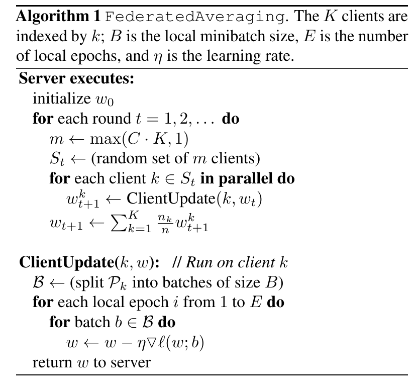

*图：FedAvg 原论文 Algorithm 1。服务端抽样客户端并按样本量加权聚合；客户端从同一全局参数出发执行多步本地 SGD。*

### 工程实现与实验设置

- MNIST：100 个客户端。IID 切分为每端 600 样本；病态 non-IID 切分先按标签排序为 200 个 shard，每个客户端只拿 2 个 shard，因此大多只含两个数字类别。
- 模型：MNIST 2NN（约 199K 参数）和 CNN（1,663,370 参数）；Shakespeare 使用两层、每层 256 单元的字符级 LSTM（866,578 参数）；另测 CIFAR-10 CNN 和大规模词级 LSTM（4,950,544 参数）。
- Shakespeare：按“剧中角色”自然划分成 1,146 个客户端，天然不平衡、non-IID；训练/测试按角色台词时间顺序切分。
- 大规模语言模型实验：约 50 万客户端、1,000 万条公开社交帖子，每轮 200 个客户端；FedAvg 用 $B=8,E=1$ 。
- 他们对学习率做了网格搜索

### 实验结果和分析

- MNIST CNN 达到 99% 准确率时，IID 下 FedSGD 需 626 轮，而 $E=20,B=10$ 的 FedAvg 只需 18 轮，约 34.8 倍通信轮数加速；病态 non-IID 下对应 483 轮与 173 轮，约 2.8 倍。
- Shakespeare 达到 54% 时，non-IID 设置下 FedSGD 需 3,906 轮， $E=5,B=10$ 的 FedAvg 只需 41 轮，约 95.3 倍。
- CIFAR-10 达到 85% 时，普通 SGD 约需 99,000 次通信式更新，FedAvg 约 2,000 轮，约 49.5 倍。
- 大规模词级 LSTM 达到 10.5% top-1 准确率时，FedSGD 需 820 轮，FedAvg 需 35 轮，约 23 倍。

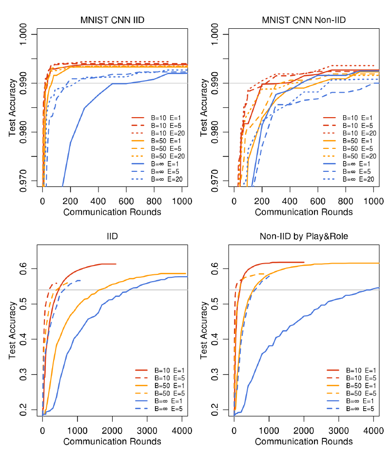

*图：FedAvg 原论文 Figure 2。增加每轮本地计算通常能明显减少达到目标准确率所需的通信轮数；non-IID 条件下收益仍存在，但不同任务的幅度不同。*

关键限制是客户端漂移：本地 $E$ 过大并非总是更好。Shakespeare 上极大的本地 epoch 会平台化或发散，论文建议在训练后期像衰减学习率一样减少本地计算量。FedAvg 只减少原始数据上传，并不自动防止梯度/参数泄漏；差分隐私和安全聚合仍需单独加入。

---

## Data-Free Black-Box Federated Learning via Zeroth-Order Gradient Estimation（FedZGE）

### 主要思想

FedZGE 要同时满足三个条件：不共享私有数据、不依赖公共辅助数据、服务端也拿不到客户端模型参数。Figure 1 展示了完整数据流：服务端生成合成样本并发给客户端；客户端只做黑盒前向，返回模型输出；服务端用这些输出更新生成器和全局模型。

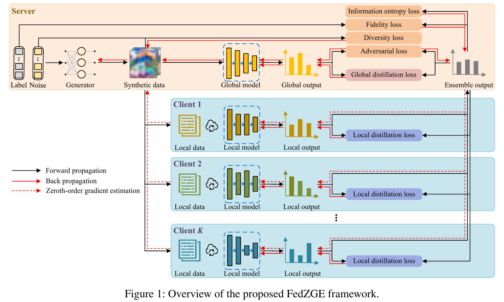

*图：FedZGE 原论文 Figure 1。黑色为前向传播，红色实线为服务端可执行的反向传播，红色虚线表示通过客户端黑盒输出完成的零阶梯度估计。*

每个客户端先在私有数据上训练本地模型：

$$
L_{k}(D_{k};\theta_{k})=\mathbb E_{(x,y)\sim D_{k}}[\mathrm{CE}(f_{k}(x;\theta_{k}),y)].
$$

服务端条件生成器 $G(z,\hat y;\theta_{G})$ 以高斯噪声和均匀随机标签为输入。生成器总目标由四部分组成：

$$
L_{G}=L_{G}^{\mathrm{fid}}+\beta_{1}L_{G}^{\mathrm{adv}}
+\beta_{2}L_{G}^{\mathrm{div}}+\beta_{3}L_{G}^{\mathrm{info}}.
$$

- **Fidelity**：生成样本应被客户端集成预测为指定标签。
- **Transferability / adversarial loss**：寻找全局模型与客户端集成意见分歧大的“难样本”，形成 $\min_{\theta}\max_{\theta_{G}}$ 的对抗博弈。
- **Diversity**：约束不同噪声产生分散的样本，缓解 mode collapse。
- **Equilibrium**：最大化 batch 预测类别分布的熵，避免合成数据偏向少数类别。

真正的难点是：生成器梯度需要穿过客户端模型，但客户端模型是黑盒。论文不直接在百万维生成器参数空间估计梯度，而是在低维合成输入空间估计：

$$
\widetilde\nabla_{\hat x}L_{G}=
\frac{1}{q}\sum_{i=1}^{q}
\frac{d\,[L_{G}(\hat x+\epsilon u_{i})-L_{G}(\hat x)]}{\epsilon}u_{i},
\quad u_{i}\sim\mathcal N(0,I),
$$

再通过可微生成器使用链式法则：

$$
\widetilde\nabla_{\theta_{G}}L_{G}=
\widetilde\nabla_{\hat x}L_{G}
\frac{\partial G(z,\hat y;\theta_{G})}{\partial\theta_{G}}.
$$

因此客户端仅需对原样本和 $q$ 个扰动样本做前向推理，无需把模型或梯度传给服务端。随后服务端用客户端加权集成输出蒸馏全局模型，并把平衡的合成样本/集成输出再发回客户端做 local distillation，缓解 non-IID。

### 工程实现与实验设置

- 数据集：CIFAR-10、CIFAR-100；用 Dirichlet $\mathrm{Dir}(\alpha)$ 制造差异， $\alpha=1$ 和 0.1。
- 联邦参数：客户端数 $K=10$ ，每轮全参与 $\varepsilon=1$ ，通信轮数 $T=100$ ，batch size $B=500$ ，默认扰动方向数 $q=10$ 。每组用 3 个随机种子。
- 同构实验：客户端和全局模型分别统一为 ResNet-18/34/50；异构实验：全局为 ResNet-50，客户端按 3:3:4 分配 ResNet-18/34/50。
- 对比：FedAvg、MHAT、DS-FL、FedGen、FedFTG、DFRD、FedZKT。

### 实验结果和分析

- CIFAR-10、同构 ResNet-50、 $\alpha=0.1$ ：FedZGE 为 $72.94\pm0.25$ %、通信 63.17 GB；FedAvg 为 $70.12\pm0.41$ %、175.30 GB；DFRD 为 $72.72\pm0.36$ %、175.30 GB。
- CIFAR-100、同构 ResNet-50、 $\alpha=0.1$ ：FedZGE 为 $44.67\pm0.36$ %、65.18 GB，高于 FedAvg 的 43.04%，并以明显更低通信量接近或超过白盒 data-free 方法。
- 异构模型下，FedZGE 在 CIFAR-10 的 $\alpha=1/0.1$ 分别达到 83.60%/72.81%，通信仍为 63.17 GB；通信量不随客户端模型规模线性增加，这是只传输出的直接收益。
- $q$ 是清晰的工程旋钮。ResNet-50、CIFAR-10、 $\alpha=0.1$ 下， $q=1,5,10,20$ 的准确率约为 72.08%、72.33%、72.94%、73.00%，通信量则约为 11.50、34.46、63.17、120.57 GB。默认 $q=10$ 是收益与通信成本的折中，而不是理论最优。
- 去掉 adversarial、diversity、information-entropy 或 local distillation 都会掉点；只保留 fidelity 的退化最明显。零阶估计接近真梯度结果，但模型越复杂估计误差越大。

FedZGE 避免直接传真实样本和模型参数。

---

## Self-Distilled Reasoner: On-Policy Self-Distillation for Large Language Models（OPSD）

### 主要思想

Figure 1 和 Figure 2 给出了 OPSD 的核心：**teacher 和 student 是同一个参数为 $\theta$ 的模型，但看到的上下文不同**。

- 学生只看问题 $x$ ： $p_{S}(\cdot\mid x)=p_{\theta}(\cdot\mid x)$ 。
- 教师多看标准答案/参考推理 $y^{\star}$ ： $p_{T}(\cdot\mid x,y^{\star})=p_{\theta}(\cdot\mid x,y^{\star})$ 。
- 学生先按当前策略生成 on-policy 轨迹 $\hat y\sim p_{S}(\cdot\mid x)$ 。
- 对学生轨迹中的每个前缀 $\hat y_{\lt n}$ ，学生和教师都计算下一 token 分布；教师通过一次带参考解的 prefill 获得“特权信息”，不单独生成一条轨迹。
- 更新时仅对学生分支反向传播，教师分布 `stop-gradient`，在本次更新中充当冻结目标。两者长期仍共享同一组不断更新的参数。

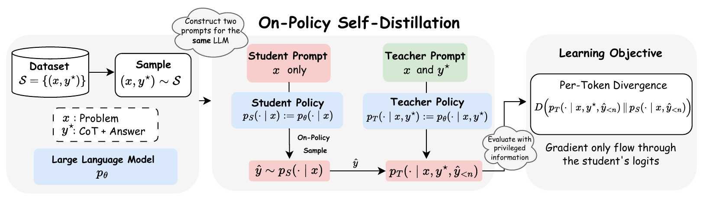

*图：OPSD 原论文 Figure 1。学生只看问题并生成 on-policy 轨迹；教师使用相同模型参数，但额外看到参考解，并在学生访问的每个前缀上提供逐 token 分布监督。*

轨迹平均的 token 级目标为

$$
D(p_{T}\Vert p_{S})(\hat y\mid x)=
\frac{1}{|\hat y|}\sum_{n=1}^{|\hat y|}
D\!\left(p_{T}(\cdot\mid x,y^{\star},\hat y_{\lt n})\,
\Vert\,p_{S}(\cdot\mid x,\hat y_{\lt n})\right),
$$

$$
L(\theta)=\mathbb E_{(x,y^{\star})}
\mathbb E_{\hat y\sim p_{S}(\cdot\mid x)}
[D(p_{T}\Vert p_{S})(\hat y\mid x)].
$$

与 SFT 相比，它训练在学生实际会访问的前缀上，减轻 exposure bias；与 GRPO 相比，教师在每个位置都给出密集分布监督，不依赖最终答案对错产生的稀疏 group reward；与常规 OPD 相比，不需要更大的外部教师。

### 工程实现

#### Per-Token Pointwise Divergence Clipping

作者观察到，KL 在词表上的贡献高度长尾，少数风格 token 的差异可能远大于真正承载数学信息的 token，导致优化方向被写作风格支配。

对一般 $f$ -divergence，在位置 $n$ 、词表项 $v$ 上定义点贡献：

$$
\ell_{n,v}^{(f)}=p_{T}(v\mid\cdot)
f\!\left(\frac{p_{S}(v\mid\cdot)}{p_{T}(v\mid\cdot)}\right).
$$

论文不是先把整个 token 位置的 KL 求和后再 clip，而是对**每个位置、每个词表项的 pointwise contribution**先截断：

$$
D_{\mathrm{clip}}^{(f)}(p_{T}\Vert p_{S})=
\frac{1}{|\hat y|}\sum_{n}\sum_{v\in V}
\min(\ell_{n,v}^{(f)},\tau).
$$

Figure 4 显示，不做这个 clipping 时 Qwen3-1.7B 的 AIME24 性能会在训练中坍塌；加入后更稳定。但作者没有调优 $\tau$ ，未给出通用最优值。

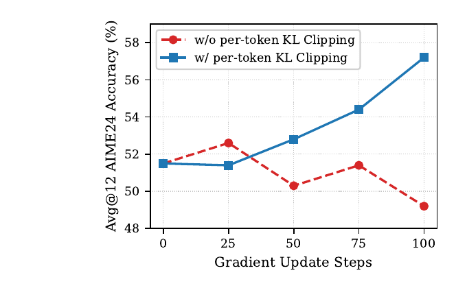

*图：OPSD 原论文 Figure 4。未使用 pointwise clipping 的曲线在后期明显退化；加入 clipping 后，AIME24 Avg@12 随训练持续改善。*

#### 训练配置

- 模型：Qwen3-1.7B/4B/8B Instruct。
- 数据：OpenThoughts 数学子集，最多 30K 个带 CoT 的问题—解答对。
- 主配置：学生 Thinking Mode off、教师 Thinking Mode on；全词表 logit distillation；LoRA rank 64、alpha 128，作用于 q/k/v/o、gate/up/down projection。
- OPSD：学习率 $5\times10^{-6}$ ，有效 batch 32，最大 completion 1,024，单 prompt 1 个 rollout，温度 1.1，共 100 步。
- GRPO：同学习率和 batch，最大 completion 16,000，每 prompt 8 个 rollout，温度 1.2，共 500 步。
- SFT：学习率 $5\times10^{-6}$ ，有效 batch 32，最大序列 16,000，100 步。
- 优化：AdamW、BF16、gradient checkpointing、FlashAttention 2。
- 硬件：所有实验使用 **8 张 A100 或 H100**；论文没有逐项说明某一具体 run 用 A100 还是 H100，也未给 wall-clock/GPU-hours。
- 评估：max new tokens 38,912，temperature 1.0，top-p 0.95，每题 12 个样本，报告 Avg@12。

### 实验结果和分析

Table 2 的主结果如下：

| 模型       |                     方法 |                             AIME24 |                             AIME25 |                             HMMT25 |                               平均 |
| ---------- | -----------------------: | ---------------------------------: | ---------------------------------: | ---------------------------------: | ---------------------------------: |
| Qwen3-8B   | Base / SFT / GRPO / OPSD | 75.8 / 72.3 / 76.4 /**77.8** | 65.6 / 64.2 / 68.9 /**70.8** | 43.9 / 42.9 /**46.7** / 45.8 | 61.8 / 59.8 / 64.0 /**64.8** |
| Qwen3-4B   | Base / SFT / GRPO / OPSD | 74.9 / 70.2 / 75.6 /**76.4** | 66.4 / 62.3 / 68.1 /**68.3** | 42.2 / 43.4 / 44.4 /**46.1** | 61.2 / 58.6 / 62.7 /**63.6** |
| Qwen3-1.7B | Base / SFT / GRPO / OPSD | 51.5 / 48.4 / 51.1 /**57.2** | 36.7 / 36.3 / 38.3 /**43.9** | 23.1 / 22.7 / 23.7 /**29.2** | 37.1 / 35.8 / 37.7 /**43.4** |

关键消融结论：

1. **前向 KL 显著好于反向 KL。** Qwen3-1.7B 的 AIME25 在 step 50/100：前向 KL 为 43.9/41.1，反向 KL 为 37.5/35.0，JSD 为 36.9/39.0，base 为 36.7。本文的教师是“同模型 + 更丰富上下文”，前向 KL 的 mode-covering 特性能够把教师认为合理的多种下一步都教给学生。
2. **全词表优于 sampled-token。** Qwen3-4B、2048-token 蒸馏预算下，full-vocabulary 在 AIME25/HMMT25 为 84.1/60.0，sampled-token 为 82.1/57.3；代价是需要保存位置数 × 词表大小的 logits，峰值显存更高。
3. **更长生成不必然更好。** 1,024 增到 4,096 token 没有一致收益。后段前缀已经给教师足够信息，后续 token 的分歧和有效梯度减少，同时计算增加。
4. **生成风格决定信号落在哪里。** Thinking Mode-off 学生 + Thinking Mode-on 教师在三种模型规模上都给数学 token 最大 KL，因此成为主设置；但风格 token 的极端值也正是必须 pointwise clipping 的原因。

---

## MOPD: Multi-Teacher On-Policy Distillation for Capability Integration in LLM Post-Training

### 主要思想

Figure 1 把训练拆成三阶段：

1. **General SFT**：得到所有后续训练共享的初始化。
2. **Domain-specialized RL**：从同一 SFT checkpoint 出发，分别训练数学、指令遵循、SWE 等专家；各领域可以并行、使用不同 RL recipe。
3. **MOPD**：学生也从 Stage-1 checkpoint 初始化；教师冻结。学生按多领域混合 prompt 自己 rollout，再按领域路由到对应教师。教师对这条学生轨迹做 prefill，给出每个 token 的分布，学生最小化逐 token 反向 KL。

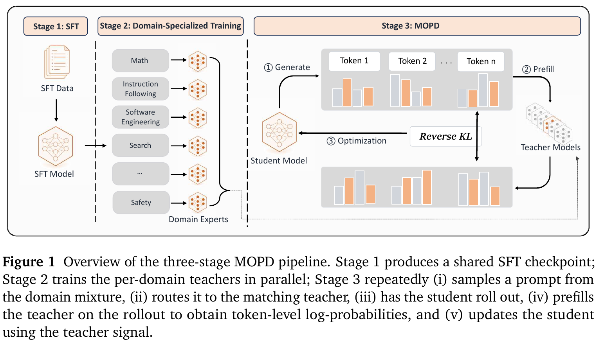

*图：MOPD 原论文 Figure 1。领域专家在 Stage 2 并行训练；Stage 3 中学生生成轨迹、教师做 prefill，并用 reverse KL 把多个领域能力整合回统一学生。*

基础目标为

$$
L_{\mathrm{revKL}}=
\mathbb E_{x,y\sim\pi_{\theta}}
\left[\frac{1}{|y|}\sum_{t}\sum_{v}
\pi_{\theta}(v\mid x,y_{\lt t})
\log\frac{\pi_{\theta}(v\mid x,y_{\lt t})}
{\pi_{\phi_{d}}(v\mid x,y_{\lt t})}\right].
$$

论文给出两种实现。

- **Policy-gradient 形式**：只在学生实际采样 token 上使用

$$
\hat A_{t}=\mathrm{sg}[\log\pi_{\phi_{d}}(y_{t})-\log\pi_{\theta}(y_{t})],
$$

并把优势双边 clip 到 $[-A_{\max},A_{\max}]$ 。这可以直接接入 PPO/GRPO。
- **Teacher top-k 形式**：在教师 top-k token 上蒸馏，默认 $k=64$ 。论文额外加入 $\pi_{\phi_{d}}(v)-\pi_{\theta}(v)$ 修正项，保证截断目标仍在 top-k 上以师生相等为最优点；同时避免传输全词表 logits。

### 工程实现

- Teacher prefill 被部署为 RL trainer 外部的独立异步服务。学生 sampler 生成完一条序列就发送请求；教师 prefill 与其他序列采样重叠。作者报告教师服务几乎没有可测的 wall-clock 额外开销，但这不等于没有 GPU 计算成本。
- Qwen3-30B-A3B 实验在三个领域： Math、Instruction Following、SWE。Math/IF 最大长度 32,768；SWE 最大长度 65,536、最多 50 轮交互。
- 每领域 RL：GRPO + Dynamic Sampling，学习率 $3\times10^{-6}$ ；Math/IF batch 144、每 prompt 8 个 rollout、约 175K 序列；SWE batch 80、8 rollout、约 150K 序列。
- Mix-RL：学习率 $4\times10^{-6}$ ，batch 256，8 rollout；Math:IF:SWE 比例 0.35:0.35:0.30。
- MOPD：不使用 Dynamic Sampling，batch 2,048，每 prompt 1 个 rollout，同样的领域比例；PG 优势 clip 上限 5，top-k 默认 64。
- 评估：AIME25/26 每题 32 个样本并报告 avg@32；IF 和 SWE 每题一次；temperature 1.0，不做 top-p/top-k 截断。
- 论文没有披露 GPU 型号、数量、训练时长或 MOPD 学习率；因此无法仅凭论文对成本进行复算。

### 实验结果和分析

#### Qwen3-30B-A3B 主结果

原论文 Table 2 给出了三个领域的逐 benchmark 准确率。Math 使用 AIME25/26，Instruction Following 使用 IFBench/IFEval，SWE 使用 SWE-bench Verified。除最后一行差值外，表中数值均为准确率（%）；归一化分数以 SFT-only 学生为 0、对应领域 RL 教师为 1。

| 方法                      | AIME25 | AIME26 | IFBench | IFEval | SWE-bench Verified | Norm. score |
| ------------------------- | -----: | -----: | ------: | -----: | -----------------: | ----------: |
| Student (SFT-only)        |  45.42 |  54.48 |   42.69 |  84.17 |              35.80 |      0.0000 |
| RL Teacher                |  54.79 |  63.65 |   78.40 |  95.50 |              51.20 |      1.0000 |
| Mix-RL                    |  52.71 |  63.75 |   75.00 |  94.58 |              48.80 |      0.8818 |
| Cascade RL                |  48.54 |  61.88 |   77.11 |  95.80 |              47.80 |      0.7752 |
| Off-Policy Finetune       |  51.56 |  63.44 |   80.95 |  93.35 |              45.80 |      0.8241 |
| Param-Merge (Avg.)        |  47.81 |  59.58 |   53.74 |  88.79 |              39.60 |      0.3280 |
| Param-Merge (Task Arith.) |  49.38 |  63.96 |   78.23 |  95.81 |              48.80 |      0.8574 |
| **MOPD**            |  51.46 |  65.31 |   77.89 |  93.84 |              50.40 |      0.9373 |
| Δ(MOPD − RL Teacher)    | −3.33 |  +1.66 |  −0.51 | −1.66 |             −0.80 |    −0.0627 |

*表：MOPD 原论文 Table 2。RL Teacher 一行表示各列对应领域的专用教师，并不是同一个教师同时在所有领域取得这些分数。*

- Qwen3-30B-A3B 上，MOPD 的归一化能力恢复分为 **0.9373**，高于 Mix-RL 0.8818、Task Arithmetic 0.8574、Off-Policy Finetune 0.8241、Cascade RL 0.7752 和简单平均 0.3280。
- MOPD 各领域恢复更均衡，三个领域归一化分数约在 0.91–0.95；但绝对分数并非每列都最佳，例如 Math AIME25 为 51.46，低于数学教师 54.79 和 Mix-RL 52.71。
- 样本效率上，MOPD 约用 25K IF、30K SWE 样本到达教师附近，而 Mix-RL 要约 150–180K。

从逐列结果看，MOPD 的优势主要是**均衡地保留多个领域能力**，而不是每个 benchmark 都取得最高绝对分数。例如 Off-Policy Finetune 的 IFBench 为 80.95，高于 MOPD 的 77.89；Task Arithmetic 的 IFEval 为 95.81，也高于 MOPD 的 93.84。MOPD 的归一化总分最高，是因为它没有像这些方法一样在某个领域留下明显短板。

#### MiMo-V2-Flash（309B）扩展结果

原论文 Table 3 将完整 MOPD 流程扩展到 MiMo-V2-Flash。这里的 Teacher 仍表示每个 benchmark 所对应的领域 RL 教师；Δ 为 MOPD 相对该教师的差值。

| 方法                | AIME25 | HMMT25 |  LCB | IFBench | SWE-Bench V. | τ²-Bench | τ²-Telecom |
| ------------------- | -----: | -----: | ---: | ------: | -----------: | ---------------: | -----------------: |
| Student             |   89.3 |   76.9 | 77.5 |    55.4 |         67.8 |             75.9 |               92.7 |
| Teacher             |   93.9 |   82.6 | 82.6 |    68.9 |         74.2 |             79.6 |               95.0 |
| **MOPD**      |   94.1 |   84.4 | 83.2 |    66.7 |         73.4 |             80.3 |               95.3 |
| Δ(MOPD − Teacher) |   +0.2 |   +1.8 | +0.6 |   −2.2 |        −0.8 |             +0.7 |               +0.3 |

*表：MOPD 原论文 Table 3。MOPD 在 7 个 benchmark 中有 5 个达到或超过对应教师，在 IFBench 和 SWE-bench Verified 上分别低 2.2 和 0.8 点。*

- 在 309B 参数 MiMo-V2-Flash 上，MOPD 在 AIME25、HMMT25、LCB、 $\tau^{2}$ -Bench 等多数项目匹配或超过教师，但 IFBench/SWE-bench Verified 低 2.2/0.8 点。

#### 蒸馏目标与教师分布对齐消融

原论文 Table 4 比较 policy-gradient 与 top-k 两种实现，并把默认的同源 RL 数学教师替换为更强但分布不同的 Qwen3-235B-A22B。表中其余 IF/SWE 教师、数据和超参数保持不变。

| Math Teacher    | Loss Variant           | AIME25 | AIME26 | IFBench | IFEval | SWE-bench Verified | Norm. score |
| --------------- | ---------------------- | -----: | -----: | ------: | -----: | -----------------: | ----------: |
| RL Teacher      | Policy gradient        |  51.46 |  65.31 |   77.89 |  93.84 |              50.40 |      0.9373 |
| RL Teacher      | Top-k distillation |  51.77 |  64.79 |   75.85 |  93.07 |              50.20 |      0.9093 |
| Qwen3-235B-A22B | Policy gradient        |  45.63 |  51.56 |   79.25 |  93.99 |              50.60 |      0.6003 |
| Qwen3-235B-A22B | Top-k distillation |   0.94 |   0.42 |   72.96 |  88.97 |              51.20 |    −1.1898 |

*表：MOPD 原论文 Table 4。使用同源教师时两种目标接近；换成异源 235B 数学教师后，policy-gradient 明显退化，top-k 蒸馏在数学任务上几乎完全坍塌。*

- 同源教师是稳定性的核心。把数学教师从同源 RL expert 换成更强但分布不同的 Qwen3-235B-A22B 后，初始逐 token KL 从约 0.04 升到约 0.19；PG 版本逐渐退化，top-k 版本约 step 18 灾难性坍塌。**教师绝对能力更强，不代表更适合做 OPD 教师。**
- 同源条件下 PG 与 top-k 接近：归一化分数 0.9373 vs. 0.9093；top-k 并没有自动带来更稳或更高精度。

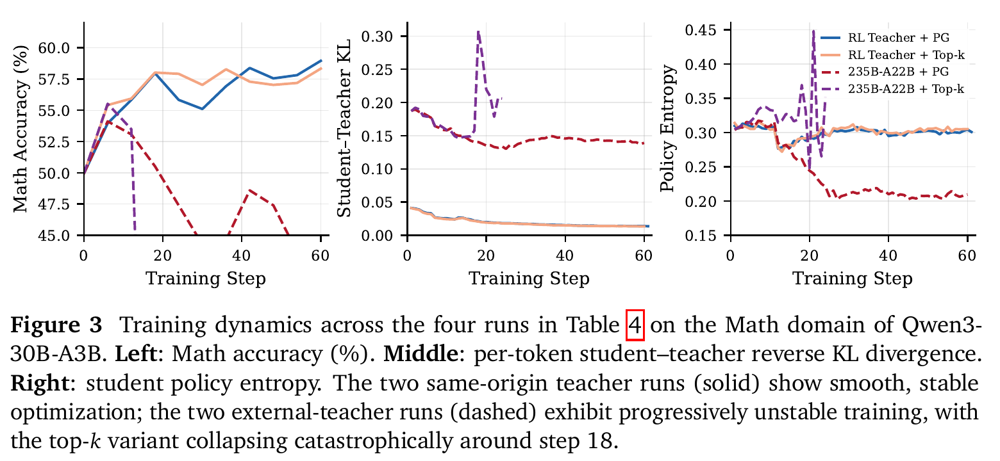

*图：MOPD 原论文 Figure 3。实线为同源 RL 教师，训练平稳且 KL 持续下降；虚线为分布不同的 235B 教师，PG 退化、top-k 约在 step 18 坍塌。*

---

## GATES: Self-Distillation under Privileged Context with Consensus Gating

### 主要思想

GATES 与 OPSD 都让同一模型承担教师和学生，但特权信息从“标准答案”变成了“源文档”，并且训练时**没有真实答案标签**。

- Tutor： $\pi_{T}(\cdot\mid d,q)$ ，看到文档 $d$ 和问题 $q$ 。
- Student： $\pi_{\theta}(\cdot\mid q)$ ，只看问题。
- 两者参数共享且训练中同步更新，不是一个永久冻结的独立教师。

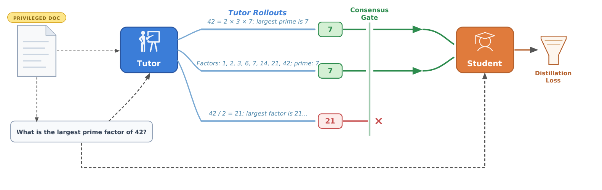

*图：GATES 原论文 Figure 1。教师基于特权文档生成多条推理轨迹；共识门保留多数答案对应的轨迹，再将其蒸馏给测试时看不到文档的学生。*

Figure 2 的 off-policy 路径是主贡献。每题采样 $k$ 条 tutor rollout，抽取最后一个 `\boxed{...}`；若至少 $\tau$ 条给出同一答案，则把众数答案作为伪标签。随后只保留“答案等于共识且不泄漏文档措辞”的教师轨迹，用完整推理轨迹监督学生：

$$
L_{\mathrm{off}}(\theta)=
-\frac{1}{\sum_{i,j}g_{i}e_{i,j}L_{i,j}^{(T)}}
\sum_{i,j}g_{i}e_{i,j}\sum_{t}
\log\pi_{\theta}(y_{i,j,t}^{(T)}\mid y_{i,j,\lt t}^{(T)},q_{i}).
$$

其中 $g_{i}$ 是问题级共识门， $e_{i,j}$ 是轨迹级资格门。不达共识的问题整题 loss 为零。

Figure 3 给出辅助的 on-policy 路径：学生自己生成轨迹，教师在有文档的条件下给采样 token 评分：

$$
A_{t}=\mathrm{clip}\bigl(
\log\pi_{T}(y_{t}^{(S)}\mid y_{\lt t}^{(S)},d,q)
-\log\pi_{\theta}(y_{t}^{(S)}\mid y_{\lt t}^{(S)},q),[-a,a]\bigr),
$$

再做 advantage-weighted log-likelihood。总目标是

$$
L=\lambda_{\mathrm{off}}L_{\mathrm{off}}
+\lambda_{\mathrm{on}}L_{\mathrm{on}}
+\lambda_{\mathrm{cons}}L_{\mathrm{cons}}
+\lambda_{\mathrm{KL}}L_{\mathrm{KL}}.
$$

实验表明真正主导提升的是 off-policy 完整轨迹蒸馏 + consensus gate，而不是 on-policy 项或稀疏共识奖励。

### 工程实现

- 模型：Qwen3-4B-Base。
- 数据：从 Nemotron-CC-Math 文档出发，用 Qwen2.5-32B-Instruct 生成问题。构造数据时要求 8 次 tutor rollout 至少 5 次一致，得到 551 个训练问题和 50 个 held-out 问题；实际训练时的在线 gate 阈值是至少 4/8。
- 每步 32 个问题，每题 8 条 tutor + 8 条 student rollout，只训练 1 个 epoch；训练温度 0.5，最大 completion 512。
- 默认 $\lambda_{off}=1.0,\lambda_{on}=0.1,\lambda_{cons}=0,\lambda_{KL}=0.02$ ，优势 clip 为 ±5。
- AdamW，学习率 $10^{-6}$ ，weight decay 0.01，gradient clipping 1.0。
- 只在 completion token 上计算 loss，prompt token mask 掉；教师/学生 prompt 结构同构，只差文档；必须成功解析最后一个 boxed answer；显式提到“document/passage/text”的题目或轨迹会被过滤。
- 论文没有披露 GPU 型号、数量、训练时长或是否使用参数高效微调。

### 实验结果和分析

- 四个无文档数学基准的 maj@8 平均分：GATES **35.4**，无 gate 的 Tutor-Trajectory SFT 32.3，Outcome RL 21.3，Base 20.2，Answer-Only SFT 16.2，带文档的 Answer-Only SFT 17.1。
- held-out 非对称评估中，学生准确率从 Base 46% 提升到 **62%**；Tutor-Trajectory SFT 为 54%，Outcome RL 为 40%，两个 Answer-Only SFT 仅 12%/10%。
- 去掉 gate，在相同 loss 权重下，benchmark 平均从 35.4 降至 31.1、in-domain 从 62% 降至 54%，直接证明可靠性过滤的贡献。
- 让 on-policy 项占主导时 in-domain 只有 48%；加入稀疏 oracle/consensus reward 也没有稳定增益。

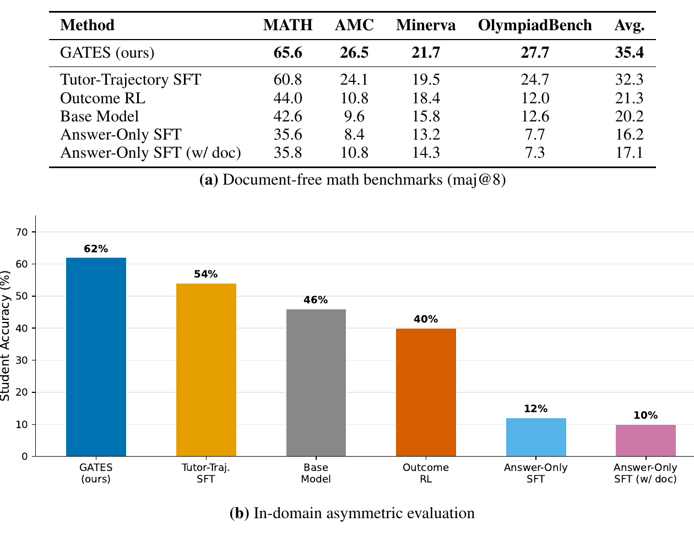

*图：GATES 原论文 Figure 4。GATES 在四个无文档数学基准上的 maj@8 平均为 35.4%，并在 held-out 非对称评估中把学生准确率从 46% 提升到 62%。*

工程含义是：在无标签自举中，“多次采样形成可信度 + 对完整可独立执行的推理轨迹学习”比把多数答案直接当作短标签安全得多。另一方面，551 个训练问题和 50 个评估问题很小，且评估 oracle 本身来自 Qwen2.5-32B 共识；结论仍需在更大、更异质的文档任务上验证。

---

## Rethinking On-Policy Distillation of Large Language Models: Phenomenology, Mechanism, and Recipe

### 主要思想

这篇论文不再只问“OPD 分数是否更高”，而是研究它何时成功、为什么成功。标准 reverse-KL OPD 写成：

$$
L_{\mathrm{OPD}}(\theta)=
\mathbb E_{x,\hat y\sim\pi_{\theta}}
\left[\sum_{t}D_{\mathrm{KL}}(p_{t}\Vert q_{t})\right],
$$

其中 $p_{t}$ 是学生在自己前缀上的分布， $q_{t}$ 是教师在同一前缀上的分布。论文同时分析 sampled-token、full-vocabulary 和 student top-k 三种粒度，并定义三个动态指标：

1. **Top-k overlap ratio**：师生高概率候选 token 集的交集比例。
2. **Overlap-token advantage**：在交集 token 内，教师相对学生的偏好差异；趋近 0 代表校准接近。
3. **Entropy gap**： $|H(q_{t})-H(p_{t})|$ ，衡量同一状态下不确定性是否匹配。

论文给出的成功条件是：

- **思维模式兼容**：教师与学生的高概率 token 支持集需要有足够重叠。
- **教师具有新知识**：高 benchmark 分数本身不够；教师需要包含学生训练中没见过的新能力，例如额外 RL 获得的策略。

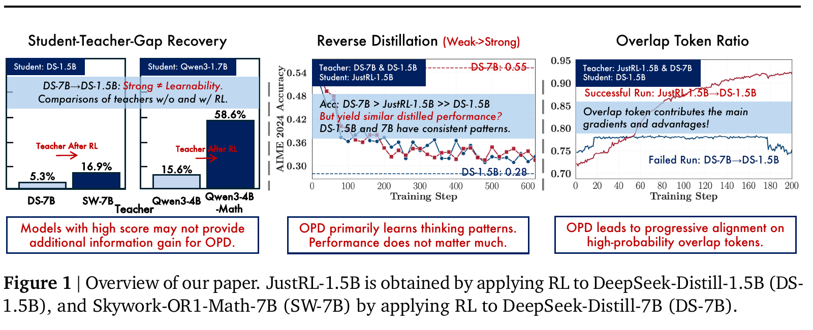

*图：Rethinking OPD 原论文 Figure 1。左侧强调“强教师不一定可学习”，中间用反向蒸馏说明 OPD 主要迁移思维模式，右侧展示成功训练对应的高概率 token 重叠增长。*

反向蒸馏实验很有说明力：把 RL 后的 JustRL-1.5B 向它自己的 pre-RL 1.5B checkpoint 蒸馏，会几乎抹掉 RL 收益；换成分数更高的同族 7B 教师，学生仍回归到近似同一水平。这表明 OPD 学到的是教师在学生访问状态上的局部分布/思维模式，而不是自动追随教师的整体 benchmark 能力。

### 工程实现

- 默认 OPD：global/mini batch 64，4 个 rollout，student top-16，temperature 1.0，top-p 1.0，最大 prompt 1,024、response 7,168，学习率 $10^{-6}$ ，1 epoch，不加 KL regularization。
- 主评估：AIME24、AIME25、AMC23；每题 16 次，temperature 0.7、top-p 0.95、最大验证长度 31,744，报告 avg@16。
- 训练教师 Qwen3-4B-Base-GRPO 时使用 8 张 A800 80GB，1 epoch，batch/micro-batch 64，8 rollout，最大 response 7,168，学习率 $10^{-6}$ 。论文没有明确披露所有 OPD run 的 GPU 型号/数量。
- Off-policy 冷启动：Qwen3-4B 教师为 OpenThoughts3 数学 prompt 生成 200K 条轨迹；Qwen3-1.7B-Base 做 full-parameter SFT，1 epoch，长度 14,336，每设备 batch 8，学习率 $10^{-5}$ ，cosine，warmup 0.05，BF16；SFT 的 GPU 数未披露。

### 实验结果和分析

#### 成功机制

成功的 JustRL-1.5B → R1-Distill-1.5B 蒸馏中，overlap ratio 从约 72% 稳步升到 91% 以上，熵差缩小；失败的 R1-Distill-7B 教师曲线基本停滞。两者共同的 top-k token 承担了师生 97%–99% 的概率质量。

只优化师生 top-k 交集，效果几乎等同完整 student top-k；只优化非交集明显更差。这说明 reverse KL 的有效作用位置是“双方已经共同认为可能”的高概率 token，训练进一步把质量集中到教师更偏好的那些 token，形成自增强循环。

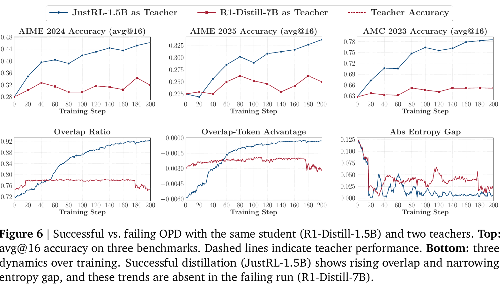

*图：Rethinking OPD 原论文 Figure 6。成功教师对应 overlap ratio 上升、overlap-token advantage 趋近 0、entropy gap 收窄；失败教师在三项指标上均基本停滞。*

#### 两个补救策略

1. **Off-policy cold start**：先用教师轨迹 SFT 把学生拉到教师附近，再做 OPD。Qwen3-1.7B-SFT 相比直接从 Base 做 OPD，初始 overlap 更高、熵差更小、后续性能上限更高。
2. **Teacher-aligned prompts**：即使题目内容相同，仅改成教师 RL 时使用的 prompt template 也能提高 overlap 和最终分数；使用教师后训练见过的 prompt 内容会让概率质量更集中于交集 token。但只用这些 prompt 会显著降低学生熵，实际应混入 teacher-OOD prompt 保持探索能力。

#### 长轨迹风险与支持集大小

- 最大 response 长度存在甜点区：0.5K/1K 的监督太少，3K/7K 最好，10K/15K 后期会出现 overlap 下降、熵和梯度范数尖峰。
- 不稳定首先发生在序列尾部，再向前传播。教师从学生前缀继续作答的准确率增益随前缀长度从 1K 的 +0.366 降到 16K 的 +0.024，说明教师在深层 student-visited states 上也逐渐失去可靠性。
- sampled-token OPD 已能达到与 top-k 接近的结果；top-1 较不稳，top-4 后收益已趋于饱和，top-16/64 更平滑但计算更贵。这与 OPSD 的“全词表更好”并不直接矛盾：OPSD 是同模型特权上下文、前向 KL；本文主要研究外部/同族教师、反向 KL，监督几何不同。

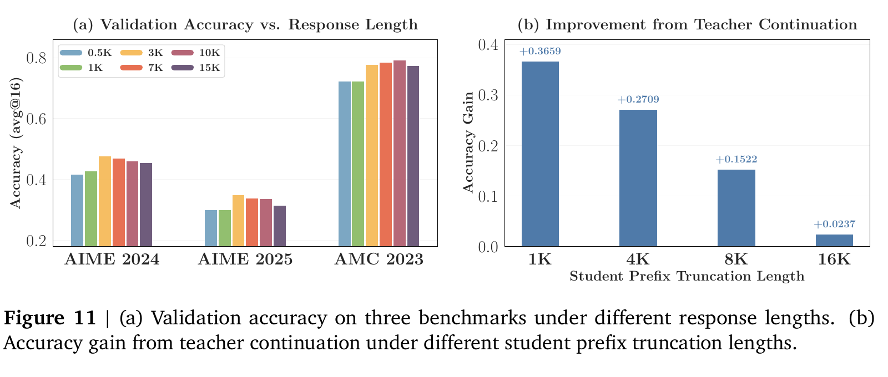

*图：Rethinking OPD 原论文 Figure 11。中等长度响应总体最好；随着学生前缀从 1K 增至 16K，教师继续生成所带来的准确率增益几乎消失。*

最后一个重要发现是：失败教师给出的 sequence-mean reward 仍能区分正确/错误 rollout，AUROC 甚至与成功教师相近（约 0.75 vs. 0.73）。所以失败可能不是全局信号没信息，而是局部 token 梯度方向相互抵消、难以利用；论文把这一点作为尚未完全验证的假说，而不是已证实机制。

---

## Rethinking Self-Distillation for Multi-Teacher Capability Merging

### 主要思想

这篇论文是对多教师自蒸馏，尤其是 MOPD 优势的严格复盘。它统一比较四种方法：

- **SFT**：在 rejection-sampled 的成功教师轨迹上做 hard-token NLL。
- **Soft-KD**：在同一教师前缀上做 full-distribution forward KL。
- **Offline-MOPD**：固定教师记录的 prompt/历史，但当前回复由学生采样，再做 reverse KL；多轮任务不执行新的环境交互。
- **MOPD**：学生生成完整 on-policy 轨迹；多轮任务实时执行学生动作并获得新环境 observation，再做 reverse KL。

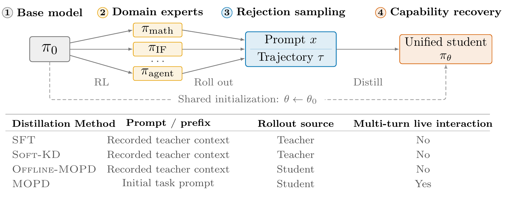

*图：Rethinking Self-Distillation 原论文 Figure 2。四种方法共享 base、领域教师和 rejection-sampled prompt；关键差别是前缀来源、rollout 来源，以及是否进行实时多轮环境交互。*

所有教师都从同一个 base checkpoint 做领域 RL；所有蒸馏方法使用同一份 rejection-sampled prompt 集。MOPD 的目标是

$$
L_{\mathrm{MOPD}}(\theta;\bar\theta)=
\sum_{d=1}^{K}w_{d}
\mathbb E_{x\sim\hat P_{d},\tau\sim p_{\bar\theta}^{d}(\cdot\mid x)}
\left[\frac{1}{|\tau|}\sum_{t}
D_{\mathrm{KL}}(\pi_{\theta}(\cdot\mid s_{t})\Vert\pi_{d}(\cdot\mid s_{t}))\right].
$$

论文不只看原始分数，而定义 in-domain capability recovery：学生相对 base 的总增益，占最佳教师相对 base 总增益的百分比；OOD 则报告相对 base 的平均分变化。

### 工程实现与实验设置

- 模型：Qwen3-1.7B、Qwen3-8B、Qwen3.5-4B-Base、Ministral-3-3B-Instruct。
- 两种教师组合：MIA（Math + Instruction Following + agentic InterCode-SQL）和 Agent×3（ALFWorld + WebShop + InterCode-SQL）。
- 教师训练：数学用 DAPO，指令用 GRPO，agent 用 GiGPO；另与 joint Mix-RL 和多种 weight merging 比较。
- 每个蒸馏方法独立训练 5 epoch，并独立扫最多 5 个学习率；最多 160 个 method × model × setting 配置，随后再做 seed 复验。每个训练 run 使用 **8 张 B200**。
- Qwen3-8B 选中学习率：MIA 下 SFT/Soft-KD/Offline-MOPD/MOPD 分别为 $(5,6.3,1,3)\times10^{-6}$ ；Agent×3 下为 $(5,5,3,3)\times10^{-6}$ 。对应 batch：MIA 32/32/24/96；Agent×3 32/32/40/40。
- 工具栈：SFT/Soft-KD 用 TRL；Offline-MOPD/MOPD/教师 RL 用 verl，多轮任务用 verl-agent；学生 rollout 和教师评分用 vLLM。
- 每个方法报告 3 个训练种子；base/teacher/merge 报 3 个评估种子。训练、验证、测试严格分开，并按验证集的多领域平均分选择 checkpoint。

### 实验结果和分析

#### 没有稳定的 MOPD 精度优势

四个模型 × 两种任务组合中，SFT、Soft-KD、Offline-MOPD 和 MOPD 的 in-domain recovery 通常都在中高 90% 区间；同一模型内最大方法差距在 MIA 不超过 3.5 点、Agent×3 不超过 4.6 点，没有一种蒸馏方法稳定胜出。

以 Qwen3-8B 为例：

- MIA：SFT 98.2%、Soft-KD 97.3%、Offline-MOPD 96.9%、MOPD 97.9%。
- Agent×3：SFT 99.0%、Soft-KD 97.6%、Offline-MOPD 97.8%、MOPD 99.3%。

跨 8 个 model-setting，MOPD 的平均 OOD 退化为 -2.5 点，优于 SFT 的 -3.6，但不是每个设置都成立。使用更大的 8B 教师蒸馏到 1.7B 学生时，MOPD 并没有受益：Agent×3 recovery 为 73.3%，而 SFT 为 99.3%；不过 SFT 的 OOD 退化更大（-14.8 vs. -3.3），体现“能力恢复”和“保留原能力”的权衡。

#### GPU-hours 改变了工程判断

Qwen3-8B、8×B200 下，全预算训练成本为：

| 设置     |   SFT | Soft-KD | Offline-MOPD |                   MOPD |
| -------- | ----: | ------: | -----------: | ---------------------: |
| MIA      | 25.90 |   51.90 |       161.35 | **383.32 GPU-h** |
| Agent×3 | 18.00 |   25.60 |       355.79 | **415.80 GPU-h** |

因此 MOPD 是 SFT 的 **14.8 倍和 23.1 倍**。即使只算最佳验证 checkpoint，MIA/Agent×3 的 MOPD 仍需 276.84/270.27 GPU-h，而 SFT 仅 14.57/4.50 GPU-h。学生 autoregressive rollout 占 OPD step time 的 86.5%–96.0%。

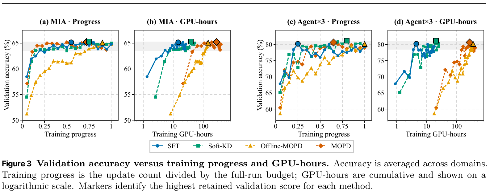

*图：Rethinking Self-Distillation 原论文 Figure 3。按训练进度看各方法最终精度接近；横轴换成累计 GPU-hours 后，SFT/Soft-KD 与两种 MOPD 的成本差距非常明显。*

这些训练成本不含一次性的教师轨迹生成、验证、测试和超参搜索。教师轨迹构造在 Qwen3-8B 上另需 13.55 B200 GPU-h（MIA）和 45.27 GPU-h（Agent×3），但这份离线数据可跨多个 SFT/Soft-KD/Offline-MOPD run 复用；MOPD 每个 run 都要重新生成学生轨迹并做教师评分。

#### 强 SFT 基线来自独立调参和数据过滤

- 仅学习率选择就能让 SFT 验证分数跨 8.5–11.3 点；把所有方法强行用同一学习率会人为削弱某些基线。
- rejection sampling 对 SFT 的 recovery 提升最大：MIA +6.5、Agent×3 +7.0 点；对 MOPD 只有约 0.5–1.6 点。
- 复现 Open-MOPD 时，baseline SFT 为 23.8，独立调参后 25.1，加入 rejection-sampled 教师数据后达到 32.1，而 OPD 为 32.6；原本显著的差距几乎消失。
- Weight merging 在 Qwen3-8B 上平均可恢复约 99.0% 教师增益，实际合并只需 CPU 分钟，但仍要用 GPU 做系数/稀疏率选择；在 1.7B 上只有约 87.3%，规模和任务重叠程度影响很大。

这篇论文并没有证明“OPD 无效”，而是更精确地说明：在同源教师、可获得成功教师轨迹且离线方法得到独立调参时，MOPD 没有稳定的精度优势，却明显更贵。若任务必须在学生自己的多轮环境状态上学习、离线轨迹无法覆盖失败恢复状态，MOPD 仍可能有独特价值；本文的结论不能无条件外推到更大模型或完全不同源教师。

---

# idea

对于Fed和OPD方法，我的理解是：

### Fed的需求：
1. 保证数据私有化更好，更不容易泄露信息
   
2. 提高训练或通信的效率

### 对于OPSD工作一些初步的新想法：
1. clipping
   OPSD原文中提到了做**Per-Token Pointwise Divergence Clipping**,他们固定裁剪超参数( $\tau=0.05$ )，没有做参数调优。针对这个问题可以做一个参数调优，或许能够根据调优结果来考虑能否扩展到自适应clipping。

2. 只蒸馏特权信息真正给的信号
   增加一个不带特权信息的Teacher做对照，两个Teacher都冻结，在student轨迹上同时计算两个教师的分布，如果两个教师分布差异大，说明特权信息（答案）对这次结果的影响大，这个token位置的信号更值得学习。
   
3. 既是教师又是学生
   OPSD的做法是：一开始两个模型权重是一样的，冻结其中一个作为teacher，但在训练过程中teacher能得到特权信息（答案）。OPSD要求数据是带有特权信息的，那我们可不可以让两个模型都带特权信息，相互优化？可能需要做一些约束，两个模型在互相优化中走偏了可能就拉不回来了。

### 大模型对我的想法进行建模

下面是我把我上面三个想法交给大模型，大模型给出的建模。

#### 统一符号

设训练数据为 $\mathcal D=\{(x_{i},z_{i})\}$ ，其中 $x$ 是问题， $z$ 是参考答案、推理过程或其他特权信息。Student 在只能看到 $x$ 的情况下生成 on-policy 轨迹

$$
\hat y\sim p_{\theta}(\cdot\mid x).
$$

在轨迹的第 $n$ 个位置，Student 和 privileged Teacher 的完整词表分布分别记为

$$
p_{n}(v)=p_{\theta}(v\mid x,\hat y_{\lt n}),
$$

$$
q_{n}^{+}(v)=p_{\bar\theta}(v\mid x,z,\hat y_{\lt n}),
$$

其中 $\bar\theta$ 表示不接收梯度的 Teacher 参数。Forward-KL 中位置 $n$ 、词表项 $v$ 的 pointwise contribution 为

$$
c_{n,v}
=q_{n}^{+}(v)\log\frac{q_{n}^{+}(v)}{p_{n}(v)}.
$$

以下三个想法都建立在同一条 Student rollout 上，因此可以在相同数据、生成预算和评测协议下做受控消融。

#### 想法一：从固定 clipping 扩展到自适应 clipping

OPSD 原文使用 **Per-Token Pointwise Divergence Clipping**，当前实验采用固定阈值 $\tau=0.05$ ：

$$
\mathcal L_{\mathrm{fixed}}
=\frac{1}{T}
\sum_{n=1}^{T}\sum_{v\in\mathcal V}
\min(c_{n,v},\tau).
$$

第一步应先做固定阈值调优。令 $\Theta(\tau)$ 表示使用阈值 $\tau$ 训练得到的模型，可以在独立验证集上选择

$$
\tau^{*}
=\arg\max_{\tau\in\mathcal T}
\mathrm{Score}\bigl(\Theta(\tau);\mathcal D_{\mathrm{val}}\bigr),
$$

其中可以先取

$$
\mathcal T=\{\infty,0.20,0.10,0.05,0.02,0.01\},
$$

$\tau=\infty$ 对应完全不裁剪。不能用最终测试集选择 $\tau$ ，否则会产生测试集泄漏；每个设置也应使用多个随机种子。

固定阈值的局限是：Math、IF、Code Client 的序列长度和 divergence 尺度不同，训练早期和后期的分布也会变化。一个自然的自适应版本是控制每个 batch 中被裁剪的正贡献比例。设 $\mathcal C_{t}^{+}$ 是第 $t$ 个 optimizer step 收集到的正 pointwise contribution，指定目标裁剪比例 $\rho$ ，则

$$
\widehat\tau_{t}
=Q_{1-\rho}(\mathcal C_{t}^{+}),
$$

其中 $Q_{1-\rho}$ 表示 $1-\rho$ 分位数。为了避免 batch 间阈值剧烈变化，可使用指数移动平均：

$$
\tau_{t}
=\beta\tau_{t-1}+(1-\beta)\widehat\tau_{t}.
$$

在联邦环境中，每个 Client 可以维护自己的阈值：

$$
\tau_{k,t}
=\beta\tau_{k,t-1}
+(1-\beta)Q_{1-\rho}(\mathcal C_{k,t}^{+}).
$$

这样调节的不是一个固定数值，而是“允许多大比例的异常贡献进入饱和区”。对应损失为

$$
\mathcal L_{k}^{\mathrm{AdaClip}}
=\frac{1}{T}
\sum_{n=1}^{T}\sum_{v\in\mathcal V}
\min(c_{k,n,v},\tau_{k,t}).
$$

除测试集得分外，还应记录两个诊断量：被裁剪词表项的比例

$$
r_{\mathrm{clip}}
=\frac{\sum_{n,v}\mathbb I[c_{n,v}\gt \tau]}{T|\mathcal V|},
$$

以及被裁剪掉的正贡献质量

$$
m_{\mathrm{clip}}
=\frac{\sum_{n,v}(c_{n,v}-\tau)_{+}}
       {\sum_{n,v}(c_{n,v})_{+}+\varepsilon}.
$$

这可以回答性能变化究竟来自合理抑制异常值，还是阈值过小导致有效监督被过度截断。

#### 想法二：只蒸馏特权信息真正带来的信号

增加一个不带特权信息的 frozen control Teacher：

$$
q_{n}^{0}(v)
=p_{\bar\theta}(v\mid x,\hat y_{\lt n}).
$$

$q_{n}^{+}$ 和 $q_{n}^{0}$ 必须使用相同权重、thinking mode、system prompt 和输出格式，唯一差异应当是是否提供 $z$ ；否则测到的可能只是提示模板或生成风格差异。

在位置 $n$ 定义“特权信息增益”为

$$
g_{n}
=D_{\mathrm{JS}}(q_{n}^{+}\Vert q_{n}^{0}).
$$

若 $g_{n}$ 很小，说明加入答案并没有明显改变 Teacher 的下一 token 分布；若 $g_{n}$ 较大，说明该位置的监督更可能来自特权答案。可以使用软门控权重

$$
w_{n}
=w_{\min}+(1-w_{\min})
\sigma\!\left(\frac{g_{n}-\gamma}{s}\right),
$$

其中 $w_{\min}\gt 0$ 防止低信息位置完全失去学习信号， $\gamma$ 控制开始增强的位置， $s$ 控制门控平滑程度。带归一化的训练目标为

$$
\mathcal L_{\mathrm{PI}}
=\frac{1}{\sum_{n=1}^{T}w_{n}+\varepsilon}
\sum_{n=1}^{T}w_{n}
\sum_{v\in\mathcal V}
\min\!\left(
q_{n}^{+}(v)\log\frac{q_{n}^{+}(v)}{p_{n}(v)},
\tau
\right).
$$

还可以加入 privileged Teacher 的置信度，避免放大“虽然受答案影响很大，但 Teacher 自己也很不确定”的位置。定义归一化置信度

$$
r_{n}
=1-\frac{H(q_{n}^{+})}{\log|\mathcal V|},
$$

再将实际权重设为 $\widetilde w_{n}=w_{n}r_{n}$ 。这个模型的核心假设是：

> 对最终能力提升最有价值的不是所有 Teacher–Student 差异，而是能够归因于特权信息、同时 Teacher 较为确信的差异。

不建议直接优化 $D(q^{+}\Vert p)-D(q^{0}\Vert p)$ ，因为减去第二项会主动推动 Student 远离无特权 Teacher，目标可能无下界并导致不稳定；将 $q^{0}$ 作为 gate 通常更安全。

建议依次比较：无 gate、基于 $g_{n}$ 的 hard gate、soft gate、soft gate 加 Teacher confidence。该方法需要额外一次 control Teacher 前向传播，因此必须同时报告训练速度和显存开销。

#### 想法三：让两个模型都既是 Teacher 又是 Student

最直接的双向互蒸馏写法是

$$
\mathcal L_{\mathrm{naive}}
=D(p_{A}^{+}\Vert p_{B}^{+})+D(p_{B}^{+}\Vert p_{A}^{+}),
$$

其中两个模型都看到同一份特权信息。但这个朴素版本有两个根本问题：

1. 如果 $A$ 、 $B$ 初始权重相同且看到相同上下文，则 $p_{A}^{+}=p_{B}^{+}$ ，初始蒸馏信号几乎为零；
2. 如果两个可训练分支始终依赖 $z$ ，它们学到的是 $p(y\mid x,z)$ ，而推理时没有 $z$ ，会产生严重的训练—推理条件不一致。

更可行的版本是 **Cross-EMA Privileged Mutual Distillation**：两个在线模型在充当 Student 时都只看问题；每个模型的 EMA 副本在充当另一个模型的 Teacher 时看到特权信息。

令两个在线参数为 $\theta_{A},\theta_{B}$ ，对应 EMA 参数为 $\bar\theta_{A},\bar\theta_{B}$ 。两个 Student 分别生成独立轨迹：

$$
\hat y^{A}\sim p_{\theta_{A}}(\cdot\mid x),
\qquad
\hat y^{B}\sim p_{\theta_{B}}(\cdot\mid x).
$$

在 $A$ 的轨迹上，由 $B$ 的 EMA privileged Teacher 教 $A$ ：

$$
s_{n}^{A}(v)
=p_{\theta_{A}}(v\mid x,\hat y^{A}_{\lt n}),
$$

$$
q_{n}^{B\rightarrow A}(v)
=p_{\bar\theta_{B}}(v\mid x,z,\hat y^{A}_{\lt n}).
$$

对应损失为

$$
\mathcal L_{A}
=\frac{1}{|\hat y^{A}|}
\sum_{n}\sum_{v}
\min\!\left(
q_{n}^{B\rightarrow A}(v)
\log\frac{q_{n}^{B\rightarrow A}(v)}{s_{n}^{A}(v)},
\tau
\right).
$$

对 $B$ 同理：

$$
\mathcal L_{B}
=\frac{1}{|\hat y^{B}|}
\sum_{n}\sum_{v}
\min\!\left(
q_{n}^{A\rightarrow B}(v)
\log\frac{q_{n}^{A\rightarrow B}(v)}{s_{n}^{B}(v)},
\tau
\right).
$$

Teacher 分支必须 `stop-gradient`，在线模型更新后再缓慢更新 EMA Teacher：

$$
\bar\theta_{A}
\leftarrow m\bar\theta_{A}+(1-m)\theta_{A},
$$

$$
\bar\theta_{B}
\leftarrow m\bar\theta_{B}+(1-m)\theta_{B},
$$

其中 $m$ 应接近 1。为了防止两个模型互相强化错误，可增加相对于初始策略 $p_{\theta_{0}}$ 的锚定项：

$$
\mathcal R_{\mathrm{anchor}}
=\frac{1}{2T}\sum_{n}
\left[
D_{\mathrm{KL}}(s_{n}^{A}\Vert p_{0,n}^{A})
+D_{\mathrm{KL}}(s_{n}^{B}\Vert p_{0,n}^{B})
\right].
$$

总目标为

$$
\mathcal L_{\mathrm{mutual}}
=\mathcal L_{A}+\mathcal L_{B}
+\lambda_{\mathrm{anchor}}\mathcal R_{\mathrm{anchor}}.
$$

这里两个模型确实都轮流承担 Teacher 和 Student 的角色，但部署时使用的仍是只依赖 $x$ 的 Student 路径。

